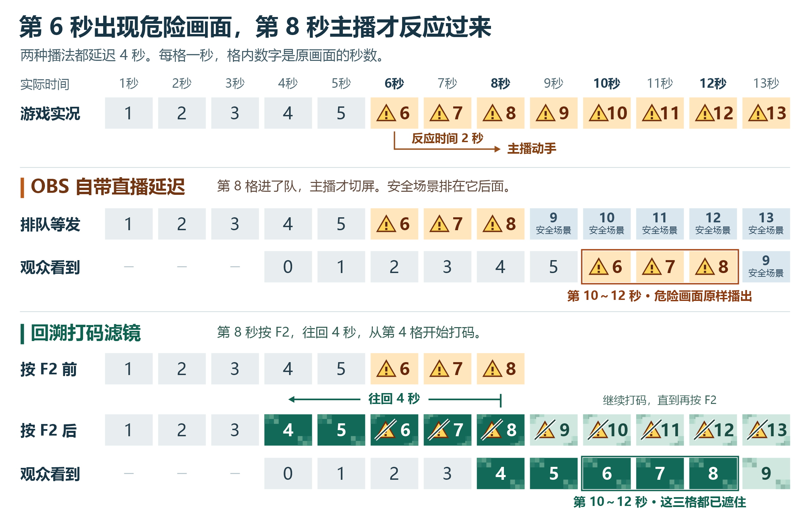
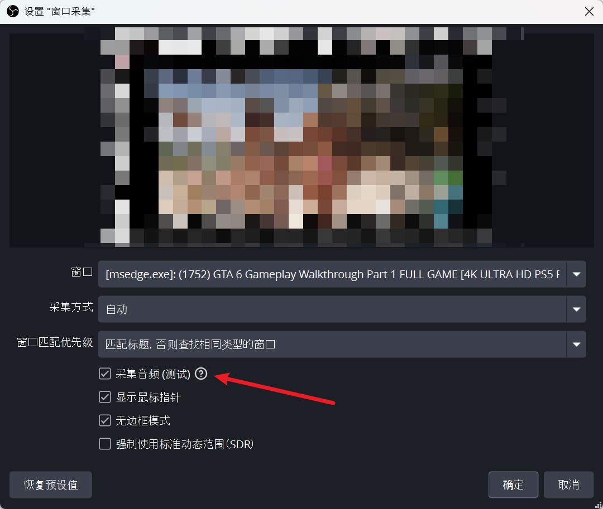
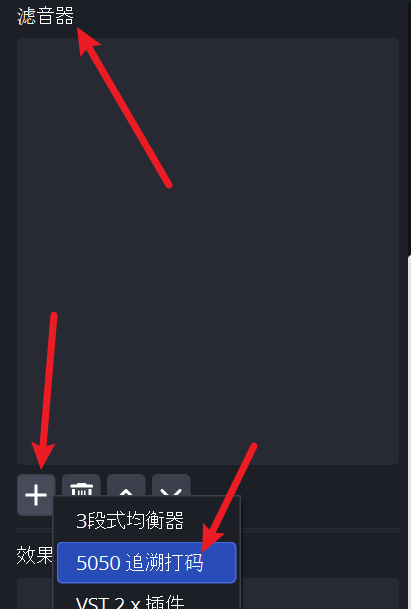
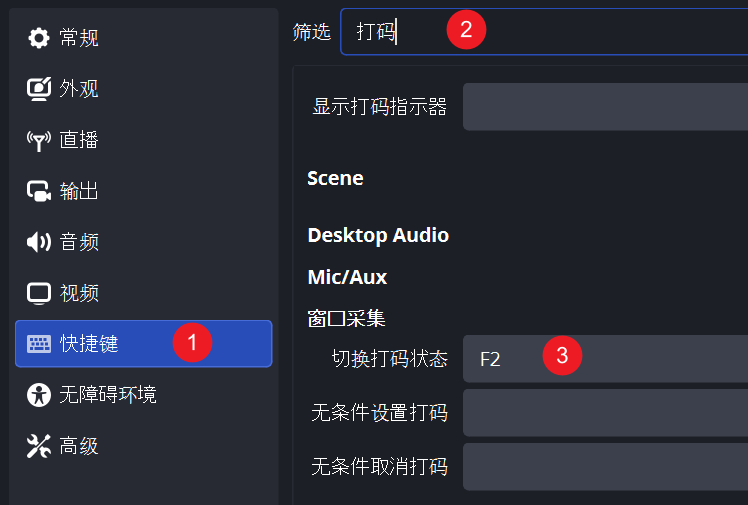
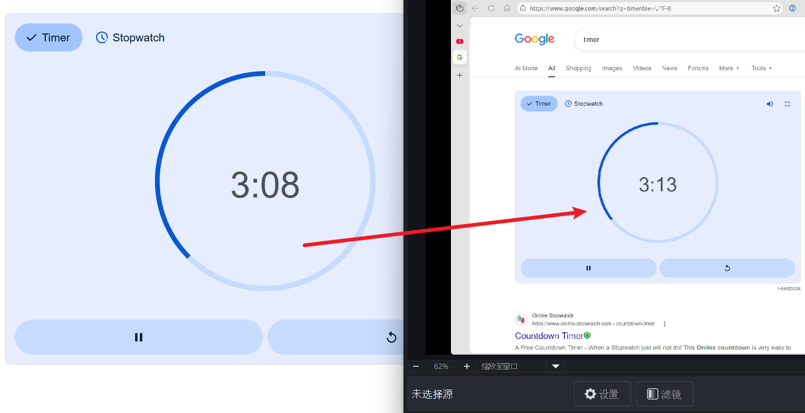

# 5050 回溯打码

众所周知，OBS 的直播延迟对于打码来说并没有用处，当你反应过来存在敏感内容时，只有关闭推流才能阻止画面被 OBS 发送。

因此，为了减少 5050 直播间红色 SC 数量，研发了这个滤镜。


## 给难以理解时序关系的人的一个直观解释

两种播法都延迟 **4 秒**。

从第 **6 秒**起，游戏画面一直有 ⚠。主播到第 **8 秒**才反应过来。

看图里两行「观众看到」，追踪 **⚠ 6、⚠ 7、⚠ 8** 最后去了哪里。



<details>
<summary>展开看只用 OBS 延迟时，安全场景什么时候播出</summary>

| 时间轴 | 主播视角                                           | OBS 画面                 | 观众视角                 | 备注         |
| ------ | -------------------------------------------------- | ------------------------ | ------------------------ | ------------ |
| 00:04  | 00:04 安全游戏画面                                 | 00:04 游戏画面           | 00:00 游戏画面           | 初始状态     |
| 00:05  | 00:05 安全游戏画面                                 | 00:05 游戏画面           | 00:01 游戏画面           |              |
| 00:06  | **⚠ 6** 危险画面出现                               | ⚠ 6                     | 00:02 游戏画面           |              |
| 00:07  | ⚠ 7                                                | ⚠ 7                     | 00:03 游戏画面           |              |
| 00:08  | ⚠ 8，主播反应过来，按下切屏                        | ⚠ 8 已排队              | 00:04 游戏画面           | 此时切屏     |
| 00:09  | ⚠ 9                                                | 安全场景                 | 00:05 游戏画面           |              |
| 00:10  | ⚠ 10                                               | 安全场景                 | **⚠ 6 原样播出**         | 吃红色 SC！  |
| 00:11  | ⚠ 11                                               | 安全场景                 | **⚠ 7 原样播出**         | 爽吃红色 SC！ |
| 00:12  | ⚠ 12                                               | 安全场景                 | **⚠ 8 原样播出**         | 继续爽吃红色 SC！ |
| 00:13  | ⚠ 13                                               | 安全场景                 | 00:09 切换后的安全场景   |              |

**为什么切屏来不及？** OBS 把做好的画面排队发送。主播切屏时，⚠ 6、⚠ 7、⚠ 8 已经在队里，安全场景排在它们后面。[OBS 直播延迟的实现](https://github.com/obsproject/obs-studio/blob/master/libobs/obs-output-delay.c)

</details>


## 安装和使用

> [!NOTE]
> 本滤镜只会在同时具有音频和视频的输出源上起效果（可以添加对应滤镜）
>
> 因此要么是「窗口采集+采集应用音频」，或者是双机直播的采集卡源

1. 将发布 ZIP 中的整个 `5050-censor-filter` 目录解压到 `C:\ProgramData\obs-studio\plugins\`。

2. 重启 OBS。右键采集来源，进入「滤镜」，在「音频／视频滤镜」中点击「＋」，添加「5050 回溯打码」。

3. 采集卡的音频输出模式选「仅采集音频」。用窗口测试时，在窗口采集的属性里开启「捕获音频（Beta）」。

4. 看着游戏机的实时画面按 F2。滤镜后的 OBS 预览与直播节目使用同一延迟。

   

### 安装方式（图）

> [!note]
>
> 以「应用窗口采集」为例，采集卡请自适应一下（没采集卡）

1. 添加一个窗口采集源，注意需要选择采集音频。

   

2. 为「应用采集源」添加一个滤镜，之后在「**滤音器**」（我知道这很扯，但是确实 OBS 把滤镜放这儿了）里面找到「5050 回溯打码」

   

3. 修改参数以适合你的反应能力


> [!note]
>
> **直播延迟**：你看到的画面多久之后才会传给用户
>
> **开始打码时向前追溯**：你按下打码键的那一刻起，向前覆盖多久，最大上限为直播延迟
>
> 5050 直播间设置为 双 4s，即直播延迟 == 打码追溯延迟
>
> 确实也推荐两者设置为相同的数值，比较直观

4. 按快捷键（默认 F2）就能打码

   快捷键在这个地方改：



1. 可以观察 obs 预览窗口和捕捉源的差异来判断是否符合预期

   > TIPS: OBS 永远显示的是用户能看到的画面

   


### 置顶状态窗

OBS 启动后会自动打开「5050 打码状态」。如果误关闭，可以在滤镜设置里面重新打开。

| 参数           | 默认值 | 行为                                                         |
| -------------- | ------ | ------------------------------------------------------------ |
| 直播延迟       | 10 秒  | 可设 0–30 秒，步长 0.1 秒。修改后重新积累缓存，期间画面为黑、音频为静音 |
| 历史追溯       | 5 秒   | 按键时向前覆盖的时间，上限为直播延迟                         |
| 切换打码状态   | F2     | 在开启和关闭之间切换                                         |
| 无条件设置打码 | 未绑定 | 开始打码并按设定时长追溯。已经开启时，重复按键会保持原来的起点 |
| 无条件取消打码 | 未绑定 | 结束当前标记。已标记的缓存画面会继续打码直至播完             |
| 显示打码指示器 | 未绑定 | 重新打开置顶状态窗。此快捷键对整个 OBS 生效                  |
| 全屏马赛克强度 | 40     | 可设 0–100。0 显示延迟原画，100 将整个来源变成一个色块       |
| 替换图片       | 留空   | 选择 PNG、JPEG 或 BMP 后，打码区间改为显示图片。图片等比缩放、完整居中 |

在 OBS「设置 → 热键」中搜索「打码」即可改键或清空。三个默认未绑定的操作各自在绑定后才会出现在指示器中，清空绑定后会再次隐藏。

例如，在源时间第 30 秒按 F2，在第 33 秒再按一次。使用默认值时，第 25 秒至第 33 秒之前的源画面会被遮蔽，观众在实际第 35 秒看到遮蔽开始，第 43 秒恢复。使用时请保持滤镜启用，滤镜列表里的眼睛按钮会旁路整个音视频延迟。


## 资源与适用范围

视频缓存在 GPU 上，采用 8 位 SDR、BT.709、4:2:0。1080p60 缓存 10 秒的像素数据约为 1.74 GiB，请注意显存大小。

## 构建

使用 Windows x64、MSVC、CMake 和 libobs 开发包。

```powershell
cmake -S . -B build -A x64 -DOBS_SOURCE_DIR=C:/sdk/obs-studio -DOBS_IMPORT_LIB=C:/sdk/lib/obs.lib
cmake --build build --config Release
cmake --install build --config Release --prefix dist
```
